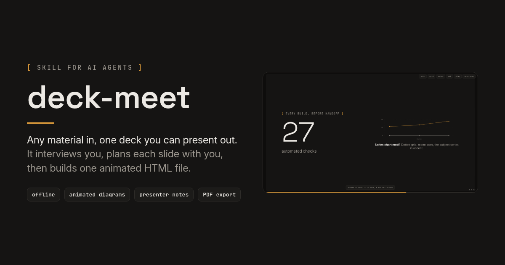
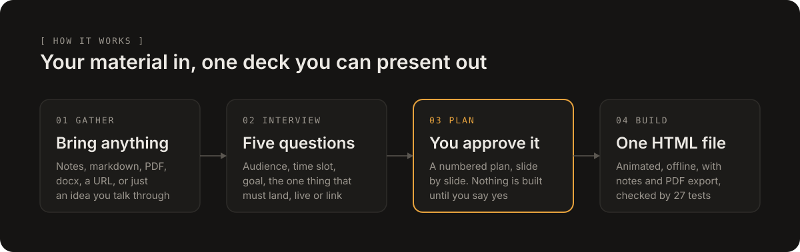
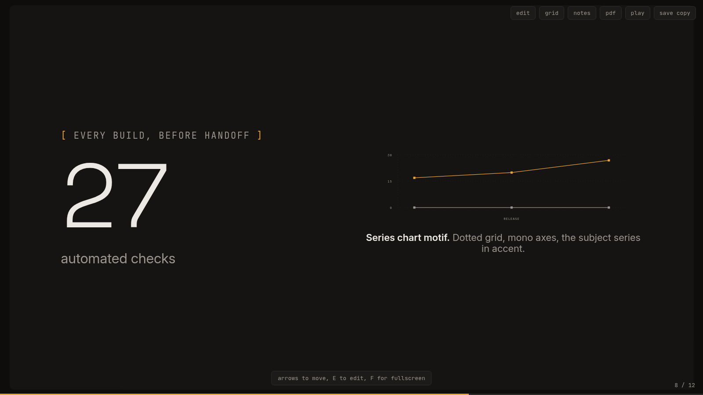
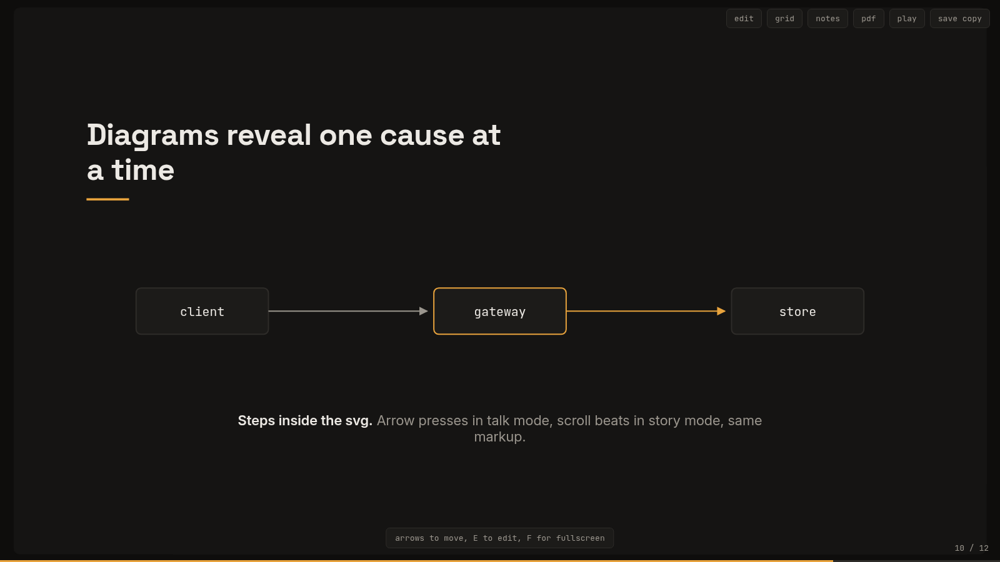
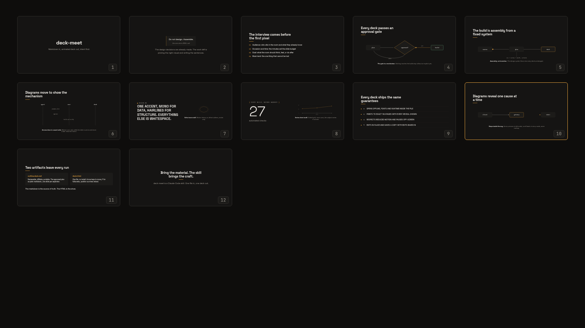
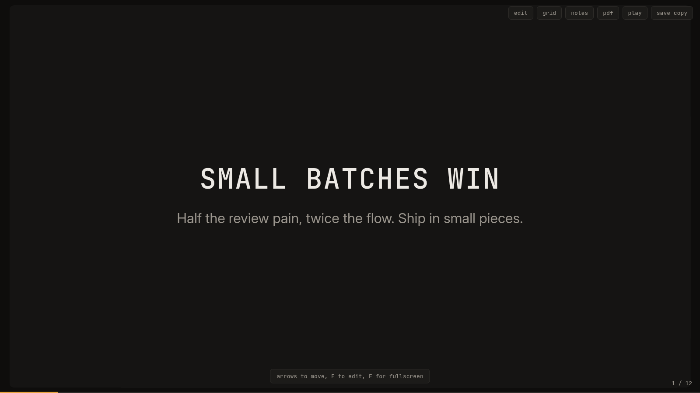

# deck-meet



An agent skill that turns any material into a presentation you can actually give. Markdown, PDF, docx, a URL, meeting notes, or just an idea you talk through: deck-meet interviews you about audience, time slot and goal, proposes a slide plan for your approval, then builds **one self-contained HTML file**.

Works in Claude Code and any agent that loads `SKILL.md` skills.

## How it works



The interview and the plan are the real work. Nothing is built until you approve the plan, so the deck says what you meant instead of what the model guessed.

## What every deck ships with

| | |
|---|---|
|  |  |
| Charts that draw themselves, numbers that count up | Diagrams that reveal one cause per key press |
|  |  |
| Overview grid (`O`), click to jump | Five heading voices, picked to fit your content |

- **Fully offline.** Fonts and runtime are inside the file. Email it, open it anywhere, no install.
- **Talk or story.** Present live with arrow keys and a presenter window (`N`: notes, clock, next slide), or share a scrolling story people read alone.
- **Edit in place** (`E`) and download a copy for last-minute changes.
- **PDF export.** The `pdf` button prints one exact 16:9 page per slide.
- **Checked before handoff.** A verifier runs 27 checks on every deck: no broken slots, no external resources, every diagram labelled for screen readers, and more.

Try it: download [`docs/demos/deck-meet-demo.html`](docs/demos/deck-meet-demo.html) and open it in a browser. The story version is [`deck-meet-story.html`](docs/demos/deck-meet-story.html).

## Install

**Claude Code** (plugin). Run these one at a time, each as its own prompt:

```
/plugin marketplace add HoneyPaptan/deck-meet
```

```
/plugin install deck-meet@deck-meet
```

**Any other agent.** Copy the `skills/deck-meet` folder into your agent's skills folder (for Claude Code without the plugin, that is `~/.claude/skills/deck-meet`).

Needs Python 3.8 or newer. Nothing else to install.

## Use it

Say what you need in plain words:

```
make me a deck from notes.md for Friday's team review
```

The agent asks five questions, shows a numbered plan, waits for your yes, builds `<name>.html` and runs the checks. Say "skip the questions" to go straight to the plan. Ask for "the outline too" for a markdown copy, or "make it a pdf" for a PDF.

## Make it yours

`skills/deck-meet/reference/theme.css` holds every colour and font token. Swap in your brand palette, and drop your own woff2 files into `reference/fonts/` if you want different fonts. Every future deck picks them up.

## Layout

- `skills/deck-meet/SKILL.md`: the workflow the agent follows (gather, interview, plan with an approval gate, build, verify, report).
- `skills/deck-meet/reference/`: the design system, the deck runtime, the SVG motif catalogue, `assemble.py` and `verify.py`.
- `scripts/package.py`: builds `dist/deck-meet.zip` for skill marketplaces and refuses to package embedded or minified code.

## License

MIT for everything in this repository except the fonts in `skills/deck-meet/reference/fonts/`, which are SIL OFL 1.1 (licence texts in the same folder).
